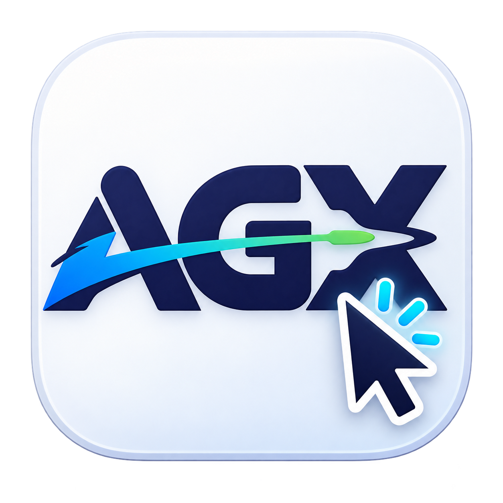

# AGX Auto Clicker



A simple native macOS auto clicker. Developed by AGX.

## Download

Get the DMG from [GitHub Releases](https://github.com/sloanagx/autoclick-mac/releases).

**Initial beta: Apple silicon Macs (M1 or newer), macOS 14 or newer.** Intel Macs are not supported by this download. The app has been tested locally on macOS 27.2; macOS 14 is the build minimum, not a claim of testing on every supported version.

This beta is ad-hoc signed, without an Apple Developer ID or Apple notarization. macOS may block its first launch. Only approve the app if you trust its source. See [Apple’s instructions for opening downloaded apps](https://support.apple.com/102445). A paid Apple Developer membership is not needed to download or use it.

## Install

1. Download and open `AGX-Auto-Clicker-1.0.0-arm64.dmg`.
2. Drag **AGX Auto Clicker** onto **Applications**.
3. Open the app from Applications. If macOS blocks it as an unidentified developer, review the message in **System Settings → Privacy & Security** and use **Open Anyway** if available and you choose to trust it. Managed Macs may disallow this.
4. Click **Enable Accessibility Access**. Enable AGX Auto Clicker in **System Settings → Privacy & Security → Accessibility**.
5. Quit and reopen the app, then eject the DMG.

## Use

- Enter a click interval from **0.05 to 3600 seconds**.
- Click **Start**. A three-second countdown gives you time to position the cursor.
- The app sends repeated left clicks at the cursor’s current position.
- Click **Stop** or press **Command–Shift–S** to stop, including while another app is active.
- Closing the app window stops clicking and quits the app.

Test at a one-second interval first. The counter measures clicks sent, not clicks accepted by another app. Timing is approximate. The stop shortcut may also reach the foreground app, conflict with its shortcuts, or be unavailable during secure keyboard input. Right clicking, fixed positions, and automatic click limits are not included.

## Privacy

The current source contains no networking, analytics, account system, or key logging. Keyboard events are observed to recognize the stop shortcut; they are not recorded or transmitted. Accessibility access is used to check permission and generate clicks.

## Build in VS Code

Install Xcode with a Swift toolchain supporting the manifest’s `swift-tools-version: 6.4`. Then, in the project terminal:

```sh
swift run
```

To build a release app and installer for the current Mac’s architecture:

```sh
bash scripts/package.sh
```

Outputs are in `dist/`. The packaging script uses local ad-hoc signing; it does not notarize the app. See [RELEASING.md](RELEASING.md) for publishing steps.

## Troubleshooting

**Clicks or the shortcut do not work:** Check Accessibility access for the app installed in Applications, then quit and reopen it. After replacing an unsigned build, you may need to remove its old Accessibility entry and add the installed app again.

**App cannot be opened:** See Apple’s instructions linked above. Do not disable Gatekeeper system-wide. Report the exact message and macOS version in [Issues](https://github.com/sloanagx/autoclick-mac/issues).

## License

Copyright © 2026 AGX. All rights reserved. You may install and use unmodified official releases. Modification, redistribution, resale, and reuse of AGX branding require written permission, except where applicable law or hosting-platform terms require otherwise. See [LICENSE](LICENSE). Share the official download link instead of rehosting the installer.
